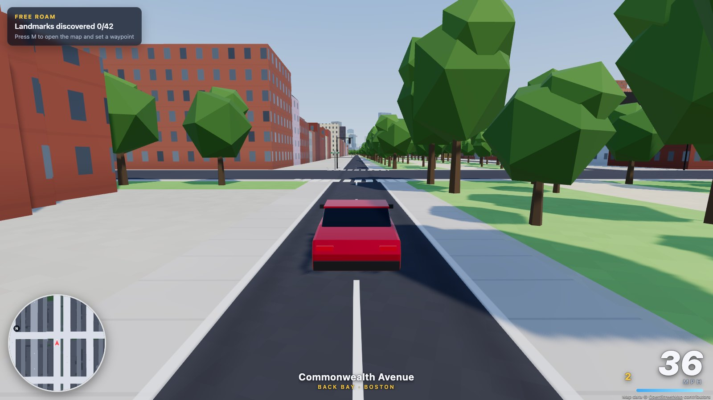
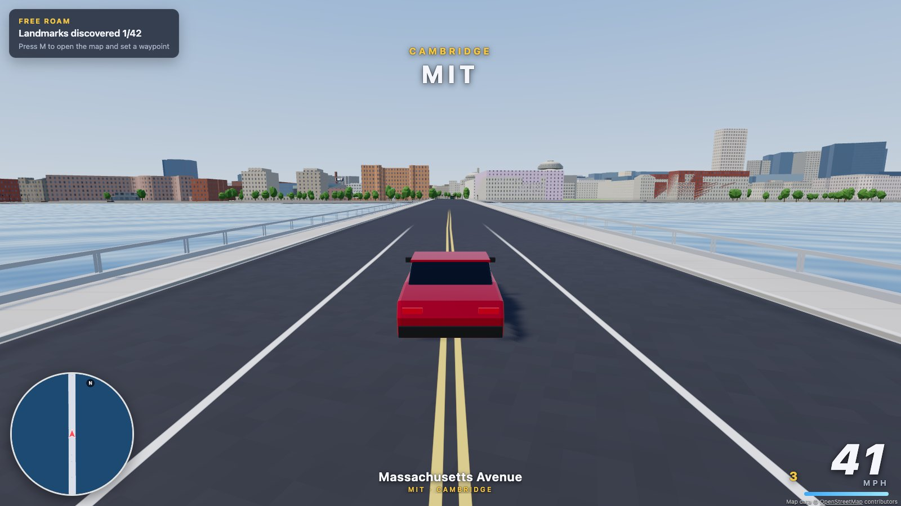
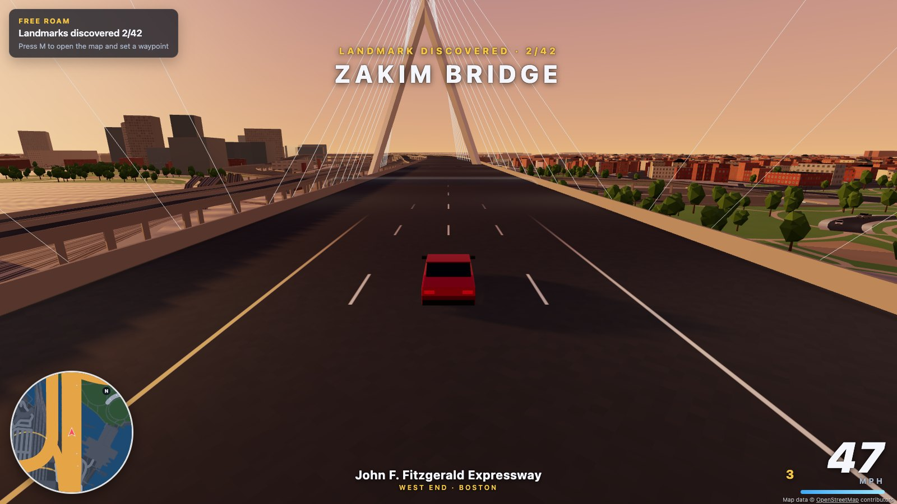
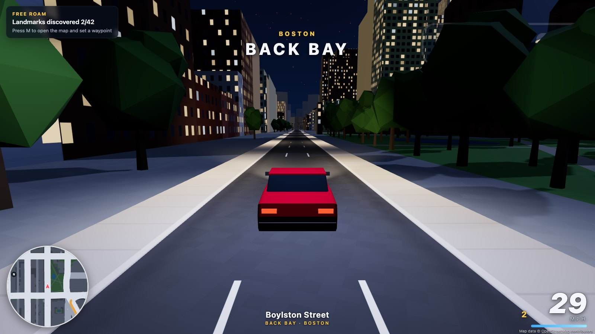
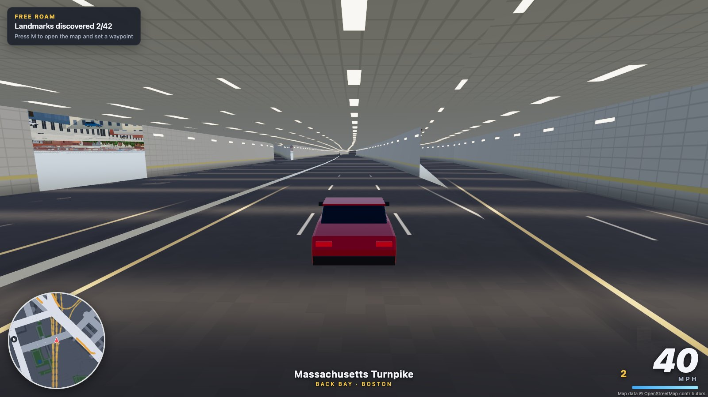
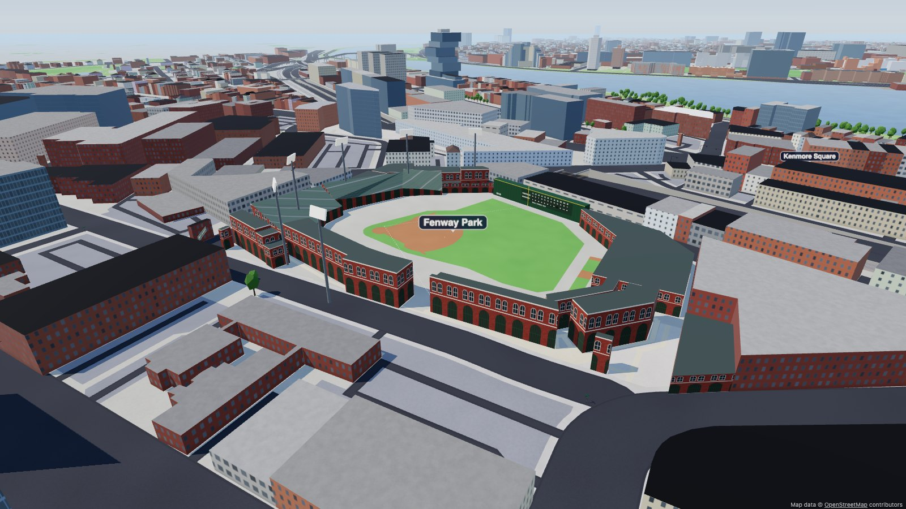
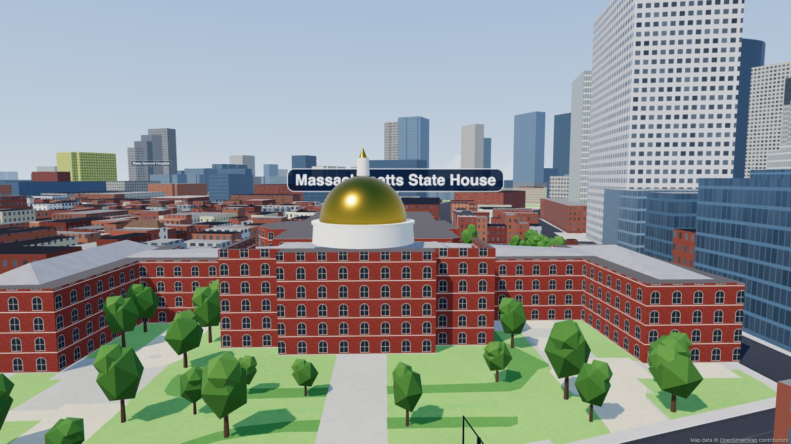
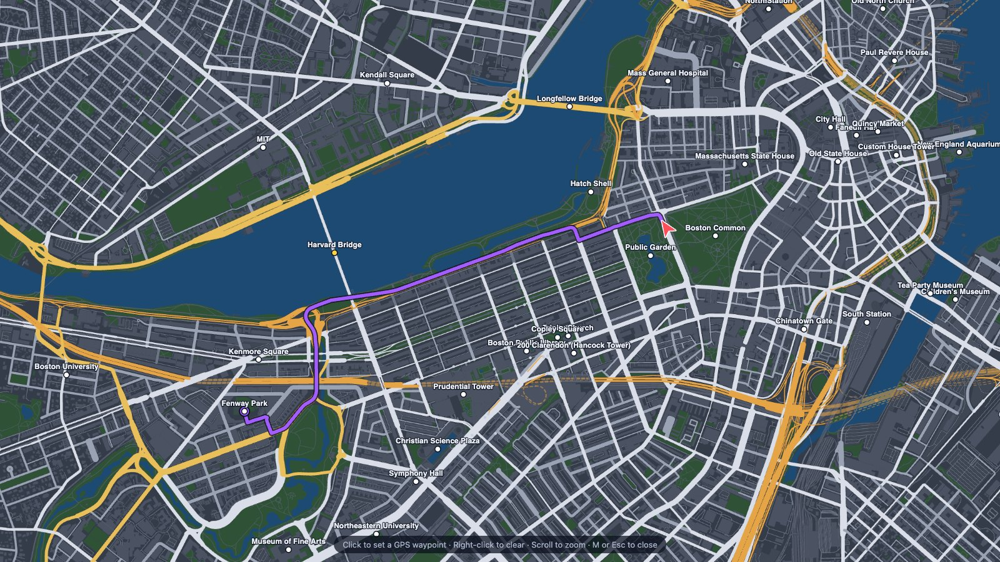

# Race Boston

An open-world driving game set in Boston, MA, playable in the browser. The city comes from
[OpenStreetMap](https://www.openstreetmap.org) data. It includes 35,000 buildings with their real heights,
10,700 streets with real names, lanes and one-way rules, the Charles River, the harbor and 18,000 trees.

The roads are 3D: drive over the Zakim and the Harvard Bridge, down the Mass Pike trench, through the
Big Dig tunnels under downtown, and under the harbor through the Sumner and Callahan tunnels.



| | |
| --- | --- |
|  |  |
|  |  |
|  |  |
|  | |

## Play

The game is a set of static files, so any local web server works. Browsers won't load the
map from a `file://` URL.

```sh
cd RaceBoston
./run.sh                           # or: python3 -m http.server 8080
```

Then open <http://localhost:8080> in Chrome, Edge, Firefox or Safari and pick a mode.

`npm start` uses a small dependency-free server (`tools/serve.mjs`) that gzips the 8 MB map
file. It's handy if you host the game on a network, but it isn't required.

## Modes

- **Garage** – the Sports Coupe does 200 mph flat out and 0-60 in 3.3 s. The Boston Cab and the Townie SUV
  trade speed for weight.
- **Free Roam** – drive anywhere and discover 42 landmarks, including Fenway Park, the State House, the
  USS Constitution, MIT and Northeastern. Press **M** and click the map to set a GPS waypoint.
- **Races** – 7 checkpoint races between real landmarks, such as the Freedom Trail Dash, Back Bay Sprint,
  Charles River Loop and The Grand Tour. Gold, silver and bronze times are derived from each route's
  length, and your best times are saved.
- **Taxi Shift** – pick up passengers, stop in the zone, and drop them off before the shift clock runs out.
  Fast, clean rides earn tips. Passengers have opinions about the Pike.

## Controls

| Key | Action |
| --- | --- |
| W / ↑ | Accelerate |
| S / ↓ | Brake, then reverse |
| A D / ← → | Steer |
| Space | Handbrake (drift) |
| Shift | Boost |
| H | Horn |
| B | Look back |
| C | Change camera (chase, far, hood, overhead) |
| M | Full map with click-to-set GPS waypoints |
| R | Reset the car onto the nearest road |
| N | Cycle day / sunset / night |
| K | Mute |
| F | Fullscreen |
| Esc / P | Pause |

Gamepads work too: RT/LT for gas and brake, A handbrake, B boost, X reset, Y camera, Start pause.
On touch devices, on-screen buttons appear automatically.

## What's in the world

Everything is generated from OSM tags at load time. There are no texture or 3D model files; textures are
painted on canvases in the browser:

- **Roads** – widths come from the lane count and road class. Lane markings follow US conventions
  (double yellow lines, dashed white lane lines, edge lines) and stop cleanly at intersections.
  There are also sidewalks with curbs, mapped crosswalks and rail lines, including the Green Line tracks.
- **Bridges, ramps and tunnels** – OSM only records vertical *order* (`bridge`, `tunnel`, `layer`), so
  `tools/elevation.mjs` infers heights. Decks clear whatever they cross (6.5 m over roads, 3 m over water)
  and tunnels sit 7.5 m down per layer. Where a street crosses an at-grade highway, the highway drops into
  a trench, which is how the Pike runs through Back Bay. Everything in between is solved as a smooth ramp,
  with grades capped at about 11%. Bridges get decks, pillars and railings or jersey barriers. Tunnels get
  tiled walls, ceilings and lights, and open cuts get retaining walls. A stencil mask hides anything
  underground except where the ground is actually open. The car has real vertical physics: it follows
  ramps, catches air off crests and can fall off an edge, so stay on the deck.
- **Street signs** – Boston-green name blades on a corner pole at about 2,200 named intersections, with
  standard abbreviations (St, Ave, Sq).
- **Landmarks** – Fenway Park has a brick arched facade, seating that slopes down to the field, the
  infield, foul lines and bases, the Green Monster with its hand-operated scoreboard, the Pesky Pole,
  light towers and a "FENWAY PARK" marquee. The State House has its gilded dome. Other
  landmarks: the Custom House clock tower, the 200 Clarendon mirror-glass tower, the Prudential with its
  mast, the Bunker Hill obelisk, the USS Constitution with masts and rigging, and Faneuil Hall's golden
  grasshopper. Trinity Church, the Boston Public Library and Quincy Market have brownstone and granite
  facades.
- **Buildings** – extruded from footprints using the `height` and `building:levels` tags, with
  Simple-3D-Buildings parts. Windows are drawn procedurally and light up at night.
- **Water** – the OSM coastline is assembled into land and sea polygons, plus the Charles River and ponds.
  Bridges over water get railings. Drive into the river and you'll splash, then get put back on the road.
- **Traffic** – AI cars drive the real road graph, respect one-way streets, stop at the 1,400+ mapped
  traffic signals, and get knocked around if you hit them.
- **GPS** – A* routing over the road network, shown on a rotating minimap and a 3D arrow.

## Project layout

```
index.html            entry point (import map -> vendored three.js)
src/                  game code (ES modules, no build step)
  main.js             bootstrap, state machine, main loop
  world.js            all static geometry (roads, buildings, water, trees)
  structures.js       bridge decks, pillars, railings, tunnels, cuts, ground mask
  landmarks.js        Fenway Park, the State House dome and other dressed landmarks
  signs.js            street name signs
  materials.js        shader patches: windows, lane markings, curbs, water waves
  vehicle.js          arcade car physics; collision.js: walls/trees/surfaces
  traffic.js          AI cars + traffic signals; roadgraph.js: graph + A*
  missions.js         free roam, races, taxi; hud.js: HUD, minimap, big map
data/boston.json      processed map (generated)
tools/                data pipeline, dev server and automated tests
vendor/               three.js r186 and earcut (MIT / ISC)
```

## Rebuilding or changing the map

The playable area is set in `tools/config.mjs`. To pull fresh OSM data or cover a different area:

```sh
npm install                 # only needed for the tools (Node 18+)
npm run fetch-osm           # downloads raw OSM data from Overpass into tools/.cache/
npm run build-map           # writes data/boston.json and tools/.cache/preview.png
```

`fetch-osm` takes a few minutes because public Overpass servers are shared and rate-limited.

## Tests

```sh
npm test                          # boots the game in headless Chrome and checks it
node tools/test-3d-roads.mjs      # autopilot drives the Pike, Big Dig, Zakim, bridges and harbor tunnels
node tools/test-autodrive.mjs     # an autopilot drives every race end-to-end
```

`npm test` checks loading, driving, braking and reversing, building collisions, splashing into the
Charles and respawning, traffic, the coupe's 200 mph top speed and 0-60 time, driving the Harvard Bridge
deck and the Pike tunnel, signs and landmarks, finishing a race, a taxi fare, GPS routing, every setting,
night mode and frame rate.
It saves screenshots to `tools/screenshots/`. The tests need Google Chrome installed; set `CHROME_PATH`
if it isn't in the default location.

## Notes

The game is plain JavaScript and WebGL (Three.js). WebAssembly wasn't needed: rendering runs on the
GPU, and the car physics, collision queries and traffic AI take well under a millisecond per frame.

Road heights are an educated guess from OSM's vertical-order tags, and the ground itself is flat (Beacon
Hill has no hill). Garage and loading-dock ramps on service roads are left out.

## Credits

- Map data © OpenStreetMap contributors, available under the
  [Open Database License](https://www.openstreetmap.org/copyright).
- [three.js](https://threejs.org) (MIT) and [earcut](https://github.com/mapbox/earcut) (ISC).
