# Race Boston

An open-world driving game set in Boston, MA, playable in the browser. The city comes from
[OpenStreetMap](https://www.openstreetmap.org) data. It includes 51,000 buildings with their real heights,
14,800 streets with real names, lanes and one-way rules, the Charles River from the Museum of Science up
past Harvard Square and the Eliot Bridge, the harbor, East Boston and Logan Airport, and 31,000 trees.
The ground comes from USGS elevation data, so Beacon Hill, Mission Hill and Bunker Hill are real hills.

The roads are 3D: drive over the Zakim and the Harvard Bridge, down the Mass Pike trench, through the
Big Dig tunnels under downtown, and under the harbor through the Sumner and Callahan tunnels. The whole
subway is there too, with tunnels and 45 stations, and you can drive the trains yourself: the Red, Orange
and Blue Lines, all four Green Line branches and the commuter rail. Trains also run the Red Line over the
Longfellow, the Green Line down Huntington and Comm Ave, and commuter rail and Amtrak into North and South
Station. Planes land on 4R over Castle Island, taxi to the gates, and take off from 4L. You can also leave
the car and fly around. The weather changes as you play (clear, cloudy, rain, thunderstorms, snow and
fog), with wet, reflective streets, snow on the roofs and trees, and HDR lighting with bloom.

Out on the river you can take a motorboat, a rowboat, a single scull, an eight or an icebreaker, and
race the Head of the Charles: three miles upstream under six bridges, against nine other crews. Crews
row and coach launches putter up and down the river. When it snows, the Charles freezes over from the
banks inward. You can drive on the ice, and icebreakers come out to cut channels through it. Or take
the helm of an icebreaker ferry, carrying commuters between landings on the frozen river: they walk
down to the landing, up the gangway and onto the foredeck, and off again at their stop.

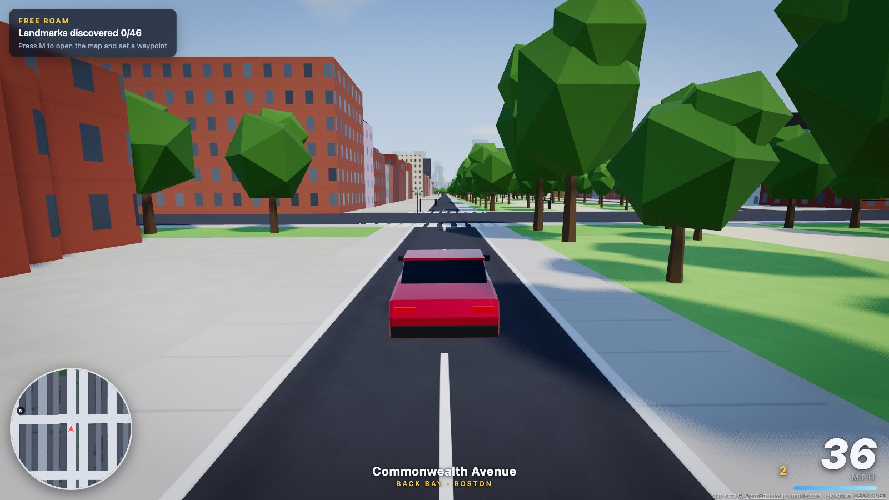

| | |
| --- | --- |
| 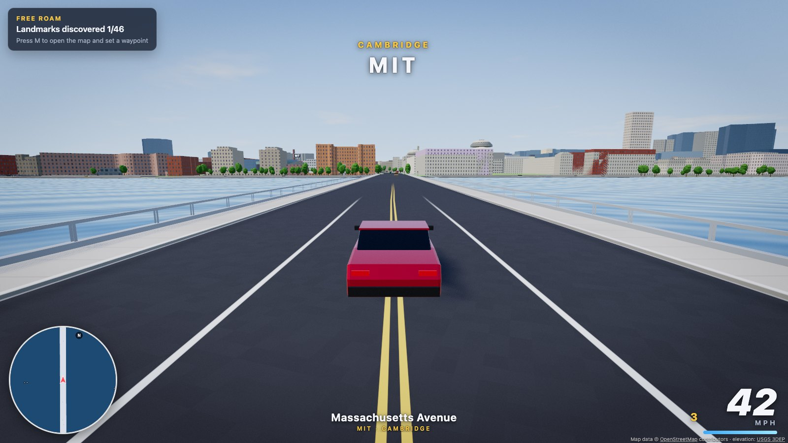 | 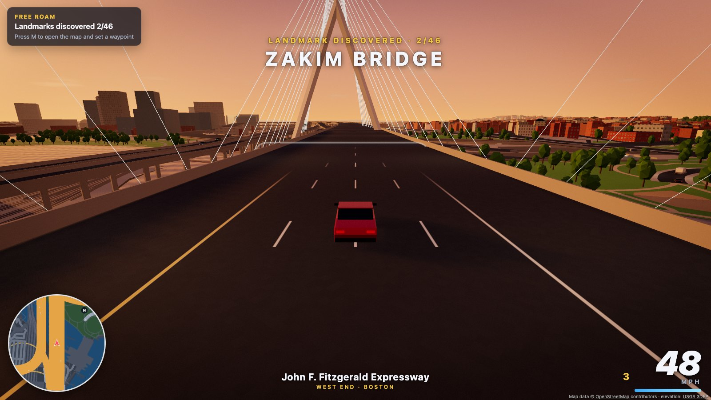 |
| 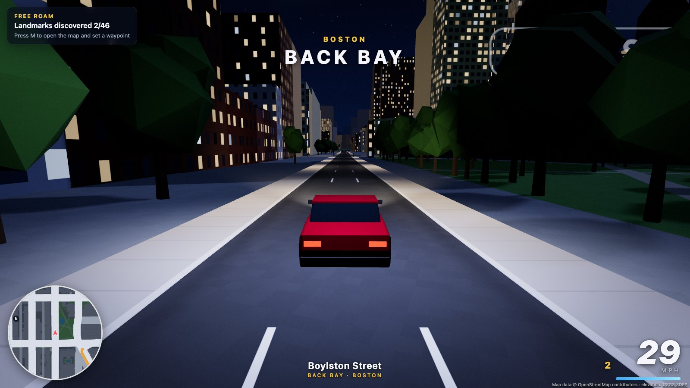 | 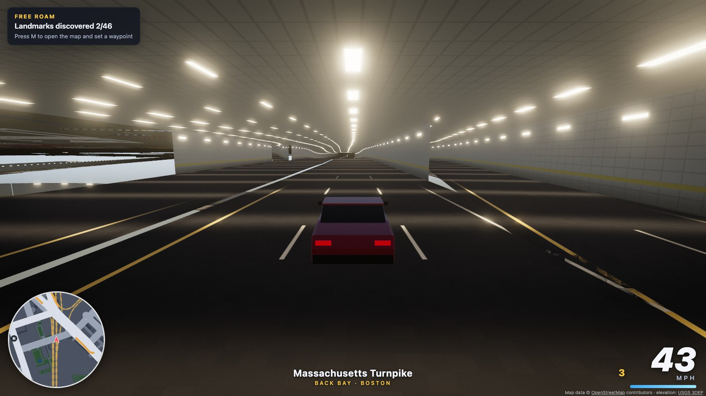 |
| 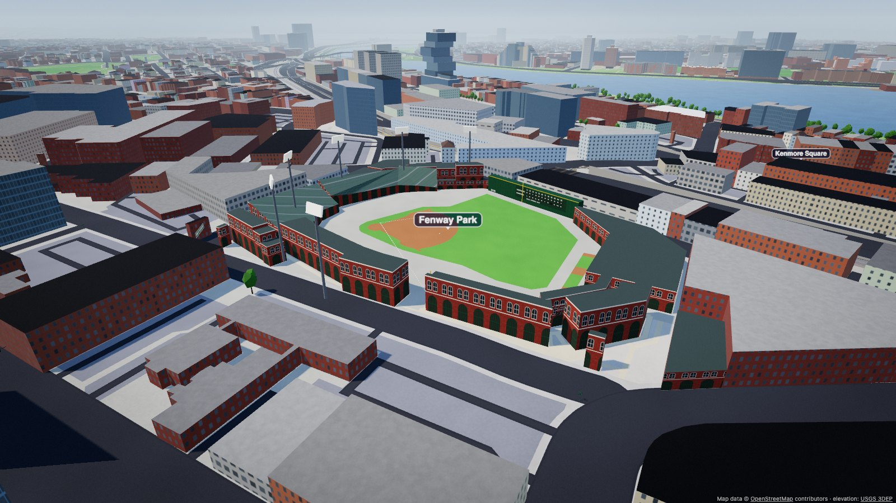 | 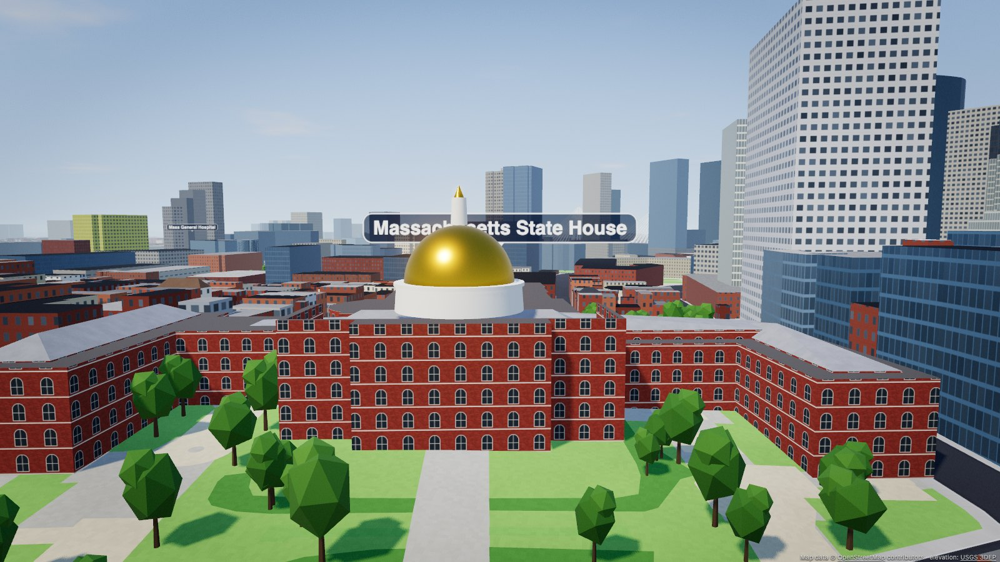 |
| 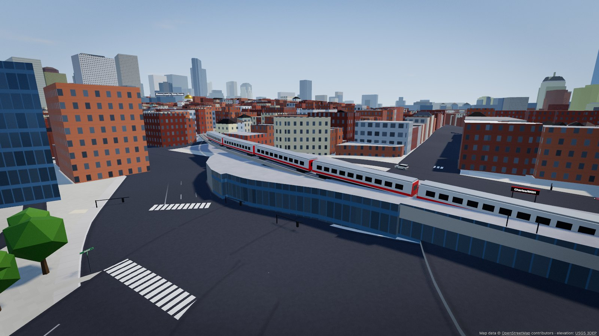 | 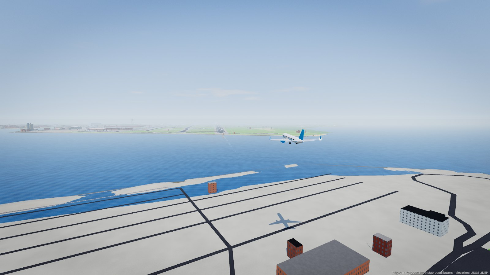 |
| 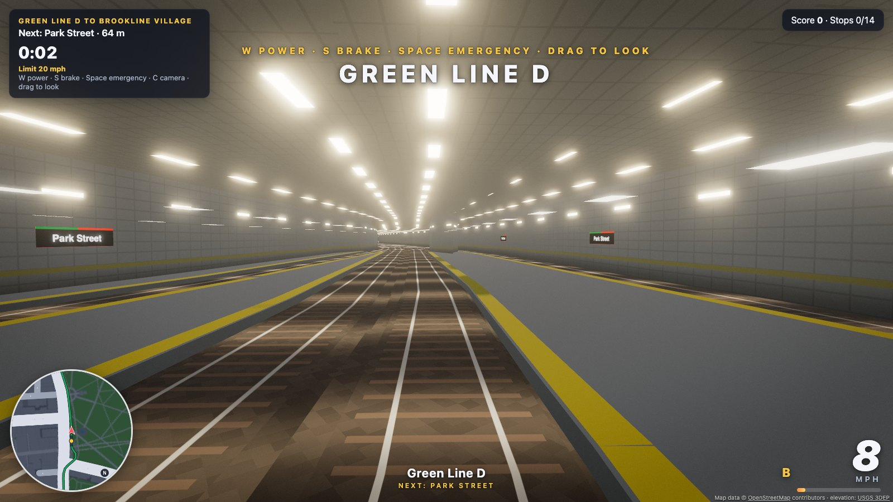 | 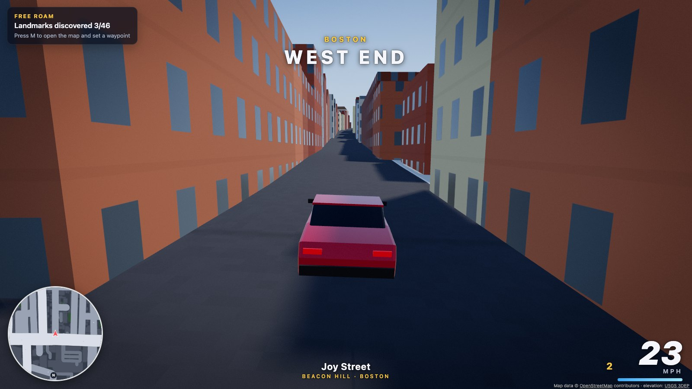 |
| 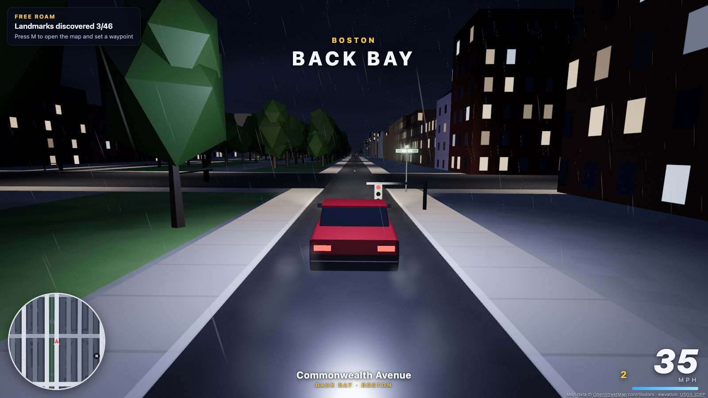 | 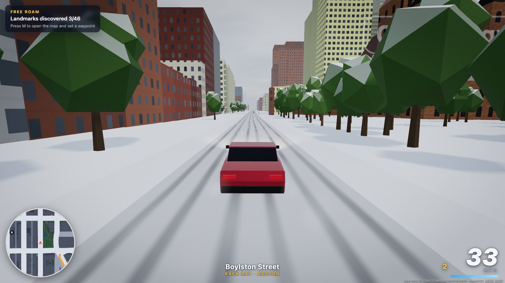 |
| 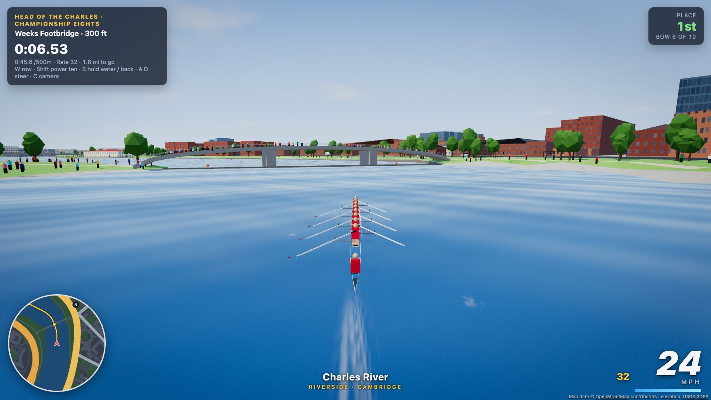 | 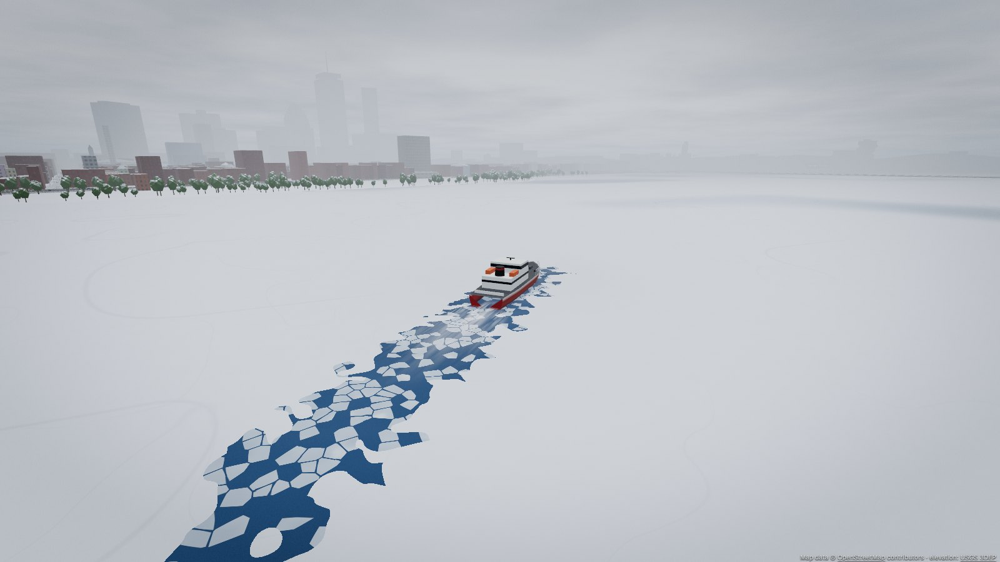 |
| 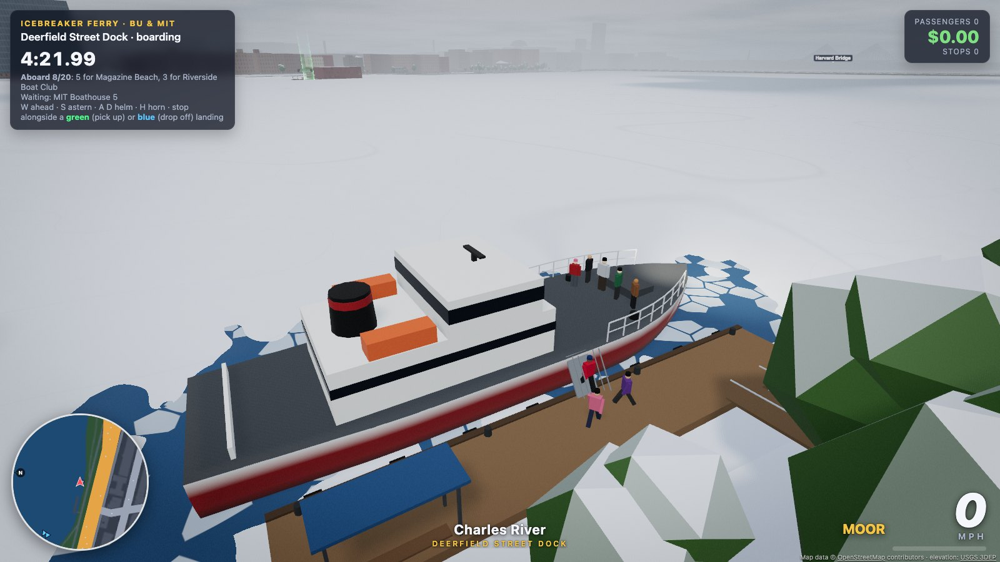 | 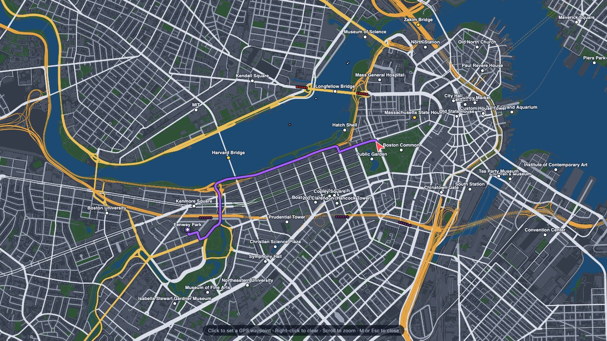 |

## Play

The game is a set of static files, so any local web server works. Browsers won't load the
map from a `file://` URL.

```sh
cd RaceBoston
./run.sh                           # or: python3 -m http.server 8080
```

Then open <http://localhost:8080> in Chrome, Edge, Firefox or Safari and pick a mode.

`npm start` uses a small dependency-free server (`tools/serve.mjs`) that gzips the 15 MB map
file. It's handy if you host the game on a network, but it isn't required.

## Modes

- **Garage** – the Sports Coupe does 200 mph flat out and 0-60 in 3.3 s. The Boston Cab and the Townie SUV
  trade speed for weight.
- **Drive a Train** – pick a line and a direction (Red Line from Harvard to Broadway, Orange Line from
  Ruggles to Sullivan Square, Blue Line out to Wood Island, the Green Line B, C, D and E branches, or the
  commuter rail into South Station) and drive it from the cab. **W** is power, **S** the brake and
  **Space** the emergency brake. Keep to the speed limit, which drops for curves and tunnels; the HUD
  warns you when a lower limit is coming. If you go well over it, the train protection stops you. At each
  station, stop with the train along the platform, close to the mark: the closer, the more points. The
  doors open, and after the dwell you're off to the next stop. Missed stops and speeding cost points, and
  each line keeps your best score. **C** switches between the cab and chase cameras.
- **On the Water** – take a boat out on the Charles. Pick one from the menu, or stop the car beside the
  river or the harbor and press **E**, which launches the last boat you used. Press **E** by the bank to go
  ashore.
  - The **motorboat** does 90 mph flat out and planes off. **Shift** gives it more punch, and it throws a
    wake.
  - In the **rowboat**, **single scull** and **eight**, hold **W** to row. The stroke rate builds over a
    few strokes, and every stroke surges the boat. **Shift** is a "power ten": a higher rate and more
    speed, while your stamina lasts. **S** holds water (blades squared in the river) and then backs the
    boat down. **A D** steer with the rudder, or spin the boat when it's stopped. The HUD shows the stroke
    rate and the split per 500 m, and **C** includes the cox's seat in the stern of the eight.
  - The **icebreaker** is a 26 m river icebreaker. It does 60 mph flat out but is slow to get going:
    0-30 mph takes about 11 s, and it needs most of a minute to reach 60. Stopping from 60 takes about
    165 m, so plan your stops. Solid ice slows it a few mph, and it smashes a channel of broken slabs
    as it goes. It fits under the BU and Eliot bridges, but the low bridges stop it, so it keeps to its
    reach of the river. When it's barely moving, a bow thruster turns it. **H** sounds the horn, and
    at night a deck light and a searchlight come on.
  - **Head of the Charles** (Championship Eights or Singles) – a three-mile head race on the real course.
    You start below the BU boathouse, go under the BU, River Street, Western Avenue, Weeks, Anderson and
    Eliot bridges, and finish by Herter Park. Ten crews start 12 s apart, and you're bow 6. It's a rolling
    start, and the clock runs from the start line. You get a split and your place at each bridge. Buoys
    mark the course, and each one you hit costs 5 s. Spectators line the banks and bridges. You finish
    with a place, a medal for the podium, the standings and your best time. On a frozen river, the race
    is rowed in a channel cleared through the ice.
  - **Icebreaker Ferry** – a shift at the helm of the icebreaker, like the taxi shift but on the river.
    There are three routes, one per reach the ship fits:
    - **BU & MIT** has six landings, including Riverside Boat Club, Magazine Beach, the DeWolfe
      Boathouse and Deerfield Street Dock.
    - **The Esplanade** runs past the sailing pavilions to the Hatch Shell.
    - **Upper Charles** runs from Herter Park and the boat clubs to past the Eliot Bridge.

    A cold snap freezes the Charles for the shift, and your weather setting comes back afterwards.

    Each landing is a floating pontoon with a shelter, a walkway up the bank and a name board.
    Passengers walk down to it in groups bound for other landings. A green beam means someone is
    waiting, and blue means you have passengers for that stop. A label over each landing lists who's
    waiting and where they're going.

    To dock, come alongside the landing slowly, with the gangway port just ahead of the deckhouse
    beside it. The lines go out and the gangway swings across. You watch the passengers for that stop
    walk off and up the bank, then the people waiting walk aboard and take their places on the
    foredeck (20 fit). The camera swings round to watch.

    Fares pay by river distance, with a tip for a quick trip. Every hard bump costs some of the tip.
    Taking a group aboard adds time to the shift clock, and delivering them adds a little more. Groups
    that wait too long give up, and your best shift is saved.
- **Fly Around** – a ghost camera that goes anywhere, through buildings and underground. Press **G** to
  start or stop flying, and **Enter** to drop the car on the road below you. On the map (**M**), click
  a spot to jump there.
- **Free Roam** – drive anywhere and discover 46 landmarks, including Fenway Park, the State House, the
  USS Constitution, MIT, Northeastern and Logan Airport. Press **M** and click the map to set a GPS
  waypoint.
- **Races** – 8 checkpoint races between real landmarks, such as the Freedom Trail Dash, Back Bay Sprint,
  Charles River Loop and The Grand Tour. The Logan Express runs from South Station to the terminals through
  the Ted Williams Tunnel, then back to the North End under the harbor. Gold, silver and bronze times come
  from an ideal lap of each route (road types, bends, braking), and your best times are saved.
- **Taxi Shift** – pick up passengers, stop in the zone, and drop them off before the shift clock runs out.
  Fast, clean rides earn tips. Passengers have opinions about the Pike.

## Controls

| Key | Action |
| --- | --- |
| W / ↑ | Accelerate |
| S / ↓ | Brake, then reverse |
| A D / ← → | Steer |
| Space | Handbrake (drift) |
| Shift | Boost |
| H | Horn |
| B | Look back |
| C | Change camera (chase, far, hood, overhead; cab and chase in a train) |
| Drag | Look around (the view eases back when you let go) |
| M | Full map with click-to-set GPS waypoints |
| R | Reset the car onto the nearest road |
| N | Cycle day / sunset / night |
| T | Cycle the weather: clear, cloudy, rain, thunderstorm, snow, fog |
| G | Fly mode on/off (mouse look, WASD, Space/Q up and down, Shift fast, wheel for speed, Enter drops the car) |
| E | Take a boat out (stopped beside the water) / go ashore |
| K | Mute |
| F | Fullscreen |
| Esc / P | Pause |

In a train, W/↑ is power, S/↓ the brake and Space the emergency brake. In a rowing boat, hold W to
row, Shift for a power ten, S to hold water and back down, and A D to steer. In the icebreaker, W is
ahead, S astern, A D the helm (the bow thruster turns her when stopped) and H the horn.

In **Settings** you can set the amount of traffic, trains (Off to Max: about 22 trains around you),
planes (Off to Max: a landing and a takeoff every minute, six overflights and a full terminal), boats on
the river and the weather (Dynamic changes every few minutes, or pick one).

Gamepads work too: RT/LT for gas and brake, A handbrake, B boost, X reset, Y camera, Start pause.
On touch devices, on-screen buttons appear automatically.

## What's in the world

Everything is generated from OSM tags at load time. There are no texture or 3D model files; textures are
painted on canvases in the browser:

- **Graphics** – the scene renders into a multisampled HDR buffer, then gets bloom on lamps, windows and
  headlights, a colour grade by time of day and weather, a vignette and ACES tone mapping. Medium uses
  FXAA instead of MSAA, and Low renders straight to the screen. The sky has a drifting cloud layer with
  silver linings. The cars have clear-coat paint, and shadows have soft edges.
- **Weather** – six kinds, and Dynamic moves between them every few minutes, blending over about a
  minute.
  - Rain and snow fall around the camera (16,000 streaks, 12,000 flakes, one draw each, none in
    tunnels).
  - In the rain, streets darken and turn glossy over half a minute, with puddles you can see rings
    spreading in, and take a couple of minutes to dry. Street lights reflect brighter on wet asphalt.
  - Snow settles on the ground, roofs and trees and stays thinner on plowed roads, with darker wheel
    tracks.
  - Fog closes in to about 200 m, and the sky disappears into it.
  - Thunderstorms flash (sky, clouds and light) with thunder a few seconds later.
  - Overcast dims the sun and softens the shadows. Rain adds a hiss.
  - Headlights come on in rain, snow and fog, and their beams show in the air. Your tyres throw up
    spray on wet roads, and raindrops bead and slide on the windscreen in the hood view and the train
    cab.
  - Grip drops by about 16% on wet roads and about 40% on snow.
- **River ice** – while it snows, the Charles freezes from the banks inward. Pancake floes drift ahead of
  the edge, and in about a minute and a half the ice closes across the river. The ponds ice over too
  (the Public Garden lagoon, the Fens, Jamaica Pond). The harbor and the tidal water below the dams stay
  open.
  - The sheet is drawn by the water shader from a 4 m grid over the river. The grid stores each spot's
    distance to the bank, plus where and when the ice was broken.
  - Once it's frozen, the ice carries a car, with a fifth of the grip, so have fun sliding. Boats are
    locked in except in open water.
  - Icebreakers work the reaches between the bridges they fit under. Each pass is in a new lane, and
    they turn around at the ends.
  - Their bow cuts a channel of broken slabs that tumble aside, with a grinding sound nearby. The
    channel freezes grey after a minute and white again a couple of minutes later. Drive into one and
    you'll go through.
  - Once the snow stops, it all thaws over a few minutes.
- **Boats** – the river's centre line (`tools/river.mjs`) is built at map-build time. The river is
  rasterised, every cell gets its distance to the bank, and a path that keeps clear of both banks is found
  from Watertown down to the Museum of Science dam. Boats follow it.
  - Rowing crews (eights, fours and singles) keep to the right and spin to row back at the ends. Coach
    launches shadow them, and motorboats roam the basin.
  - Crews steer between bridge piles, ease off behind you, and turn back.
  - Shells have riggers and sliding seats, and their oars are animated through the catch, drive, finish,
    feathered recovery and squaring up. Coxes sit in the stern.
  - Your hull collides with the banks, piers, bridge piles, other boats and solid ice (an icebreaker
    rams through ice instead, but stops at a bridge lower than its 6.4 m superstructure). Ferry
    landings are fendered: the hull slides along them rather than sticking. Wakes spread in two arms
    behind anything with an engine.
  - Ferry passengers are instanced figures in winter coats and hats, with arms and legs that swing as
    they walk. They walk paths from the street down the walkway to the landing, then over the gangway.
    Once aboard they ride in the ship's own frame, so nobody is left floating when she casts off.
  - Footbridges over the water, such as the Weeks Bridge, rise into arches on piers that boats pass
    between and cars can cross.
- **Terrain** – heights come from the USGS 3D Elevation Program, through the AWS Terrain Tiles
  (`tools/fetch-dem.mjs`), resampled to a 10 m grid. The highest point is 67 m on Parker Hill above
  Mission Hill; the State House sits at 27 m on Beacon Hill and the Bunker Hill Monument at 24 m.
  Water is flat at its own level and the banks stay above it. Every map layer (parks, streets,
  sidewalks, crosswalks, runways, rail) is draped over the ground, and buildings stand on the lowest
  ground under their footprint. Road and rail heights from the elevation solver are relative to the
  ground, and decks are smoothed between their ends, so a bridge doesn't step with the riverbank
  under it. The car climbs and coasts on real slopes.
- **Roads** – widths come from the lane count and road class. Lane markings follow US conventions
  (double yellow lines, dashed white lane lines, edge lines) and stop cleanly at intersections.
  There are also sidewalks with curbs, mapped crosswalks and rail lines, including the Green Line tracks.
- **Bridges, ramps and tunnels** – OSM only records vertical *order* (`bridge`, `tunnel`, `layer`), so
  `tools/elevation.mjs` infers heights. Decks clear whatever they cross (6.5 m over roads, 3 m over water)
  and tunnels sit 7.5 m down per layer. Where a street crosses an at-grade highway, the highway drops into
  a trench, which is how the Pike runs through Back Bay. Everything in between is solved as a smooth ramp,
  with grades capped at about 11%. Bridges get decks, pillars and railings or jersey barriers. Tunnels get
  tiled walls, ceilings and lights, and open cuts get retaining walls. A stencil mask hides anything
  underground except where the ground is actually open. The car has real vertical physics: it follows
  ramps, catches air off crests and can fall off an edge, so stay on the deck.
- **Logan Airport** – all six runways have FAA-style markings and painted numbers, plus taxiways with yellow
  lines, hold-short bars and 166 real stands. At night there are edge, centreline, threshold and taxiway
  lights, and a sequenced strobe on the approach. Airliners (narrowbody, widebody and regional, in
  fictional liveries) work on a loop:
  - Arrivals join a 3° glidepath to 4R, flare, roll out, take a high-speed exit and taxi to a free stand,
    holding short of 4L when departures are rolling.
  - Departures push back, taxi, hold short, line up and take off from 4L, then turn toward their
    destinations over the city.
  - Arrivals are spaced about a minute apart, and go around if the runway is still occupied.
  - Overflights cross at altitude.
  - Planes on the ground stop for your car and are solid. You can hear the jets.
- **Trains** – OSM route relations tell which track each line uses. Red, Orange and Blue Line cars,
  two-car Green Line trolleys with pantographs, MBTA bilevel commuter trains, Amtrak and Grand Junction
  freight all follow the real track. They stop at stations, reverse at terminals, and slip into tunnel
  portals. Trains are solid, so don't park on the tracks. While you drive a train, the others run in the
  tunnels too, but stay off your line.
- **The subway** – tunnels follow the ground about 9-11 m down. They go deeper per OSM `layer`, and
  where two lines cross, the lower one passes at least 8 m under the other, ramping down at 4%. Tracks
  side by side share one box with tiled walls, lamps and a ceiling, and ramp up at 4.5% to their
  portals through open cuts with retaining walls. Station platforms come from their OSM outlines: high
  platforms for the Red, Orange and Blue Lines and low ones for the Green Line and commuter rail, with a
  yellow edge strip. Underground stations have bright ceiling lights and a taller hall, and the wall
  steps back behind each platform. Name boards carry each line's colour. In a tunnel the daylight dims
  and the distance fades to dark.
- **Street signs** – Boston-green name blades on a corner pole at about 2,200 named intersections, with
  standard abbreviations (St, Ave, Sq).
- **Landmarks** – Fenway Park has a brick arched facade, seating that slopes down to the field, the
  infield, foul lines and bases, the Green Monster with its hand-operated scoreboard, the Pesky Pole,
  light towers and a "FENWAY PARK" marquee. The State House has its gilded dome. Other
  landmarks: the Custom House clock tower, the 200 Clarendon mirror-glass tower, the Prudential with its
  mast, the Bunker Hill obelisk, the USS Constitution with masts and rigging, and Faneuil Hall's golden
  grasshopper. Trinity Church, the Boston Public Library and Quincy Market have brownstone and granite
  facades.
- **Buildings** – extruded from footprints using the `height` and `building:levels` tags, with
  Simple-3D-Buildings parts. Windows are drawn procedurally and light up at night.
- **Water** – the OSM coastline is assembled into land and sea polygons, plus the Charles River and ponds.
  Bridges over water get railings. Drive into the river and you'll splash, then get put back on the road.
- **Traffic** – AI cars drive the real road graph, respect one-way streets, stop at the 1,400+ mapped
  traffic signals, and get knocked around if you hit them.
- **GPS** – A* routing over the road network, shown on a rotating minimap and a 3D arrow. It will cut the
  wrong way down a one-way street, but never up a highway or a ramp.

## Project layout

```
index.html            entry point (import map -> vendored three.js)
src/                  game code (ES modules, no build step)
  main.js             bootstrap, state machine, main loop
  world.js            all static geometry (roads, buildings, water, trees)
  structures.js       bridge decks, pillars, railings, tunnels, cuts, ground mask
  terrain.js          ground heights and draping map layers over the hills
  railworld.js        subway tunnels, rail cuts, portals, station platforms and name boards
  trainmode.js        driving a train: lines, controls, speed limits, stops, cab/chase camera
  landmarks.js        Fenway Park, the State House dome and other dressed landmarks
  signs.js            street name signs
  trains.js           AI trains on the rail network (and drawing yours)
  airport.js          Logan's runways, taxiways, markings and airfield lights
  planes.js           aircraft: arrivals, taxiing, departures, overflights
  fly.js              ghost camera for fly mode
  boats.js            boats: river centre line, hull physics, rowing, models, AI crews, icebreakers, wakes
  boatmode.js         on the water: boat mode, E to board / go ashore, the Head of the Charles race
  ferry.js            Icebreaker Ferry: landings, passengers boarding and getting off, the shift
  ice.js              river ice: freezing and thawing, the ice grid, broken channels
  materials.js        shader patches: windows, lane markings, curbs, water waves and ice, wet / snowy surfaces
  post.js             post-processing: HDR, bloom, colour grade, lens rain, tone mapping, FXAA
  weather.js          weather states, rain and snow, lightning, wetness and snow cover
  effects.js          skid marks, tyre spray, headlight beams
  vehicle.js          arcade car physics; collision.js: walls/trees/surfaces
  traffic.js          AI cars + traffic signals; roadgraph.js: graph + A*
  missions.js         free roam, races, taxi; hud.js: HUD, minimap, big map
data/boston.json      processed map (generated)
data/terrain.bin      10 m ground height grid (generated)
tools/                data pipeline, dev server and automated tests
vendor/               three.js r186 (with its post-processing add-ons) and earcut (MIT / ISC)
```

## Rebuilding or changing the map

The playable area is set in `tools/config.mjs`. It reaches west to Harvard Square and the Eliot Bridge so
the whole Head of the Charles course is detailed. To pull fresh OSM data or cover a different area:

```sh
npm install                 # only needed for the tools (Node 18+)
npm run fetch-osm           # downloads raw OSM data from Overpass into tools/.cache/
npm run fetch-dem           # downloads elevation tiles (AWS Terrain Tiles) into tools/.cache/dem/
npm run build-map           # writes data/boston.json, data/terrain.bin and tools/.cache/preview.png
```

`fetch-osm` takes a few minutes because public Overpass servers are shared and rate-limited.
`./run.sh --rebuild` runs all three.

## Tests

```sh
npm test                          # boots the game in headless Chrome and checks it
node tools/test-3d-roads.mjs      # autopilot drives the Pike, Big Dig, Zakim, bridges and harbor tunnels
node tools/test-autodrive.mjs     # an autopilot drives every race end-to-end, with checkpoint splits
node tools/test-trains.mjs        # an autopilot drives every train line, stopping at every platform
```

`npm test` checks loading, driving, braking and reversing, building collisions, splashing into the
Charles and respawning, traffic, the coupe's 200 mph top speed and 0-60 time, the hills (and driving up
Beacon Hill), driving the Harvard Bridge deck and the Pike tunnel, signs and landmarks, fly mode (flying
through buildings and dropping the car), trains running and being solid, the subway's tunnels and
stations, drag to look, train mode (driving the Red Line underground from Harvard to Central and stopping at the
platform, AI trains in the tunnels), planes parked at Logan, landing and taking off, the plane settings,
rain and snow (wet and snowy roads, less grip, the T key, a rainy night that still renders), boats (the On
the Water menu and the course, a motorboat at speed, crews on the river, bouncing off the bank, rowing an
eight, E to board and go ashore, the Head of the Charles from countdown to standings), the icebreaker (60
mph and slow to accelerate, stopped by a low bridge), the Icebreaker Ferry (landings, passengers walking
aboard, docking alongside, passengers getting off and paying), river ice (snow
freezing the Charles, driving on it, icebreakers cutting channels, falling through one), finishing a
race, a taxi fare, GPS routing (checkpoints on ordinary streets, never the wrong way up a ramp), bridge
pillars clear of the roads below, every setting, night mode and frame rate. It saves screenshots to
`tools/screenshots/`. The tests need Google Chrome installed; set `CHROME_PATH` if it isn't in the
default location.

## Notes

The game is plain JavaScript and WebGL (Three.js). WebAssembly wasn't needed: rendering runs on the
GPU, and the car physics, collision queries and traffic AI take well under a millisecond per frame.

Road and tunnel heights are an educated guess from OSM's vertical-order tags. The ground is real, but
the solver still works relative to it: a road keeps its height above the ground, so a highway on a
hillside follows the hill. Subway depths are a guess too: OSM records which tunnel is below which, not how
deep they are. Garage and loading-dock ramps on service roads are left out.

## Credits

- Map data © OpenStreetMap contributors, available under the
  [Open Database License](https://www.openstreetmap.org/copyright).
- Elevation: USGS 3D Elevation Program (3DEP), via the
  [AWS Terrain Tiles](https://registry.opendata.aws/terrain-tiles/) open dataset (terrarium format).
- [three.js](https://threejs.org) (MIT) and [earcut](https://github.com/mapbox/earcut) (ISC).
